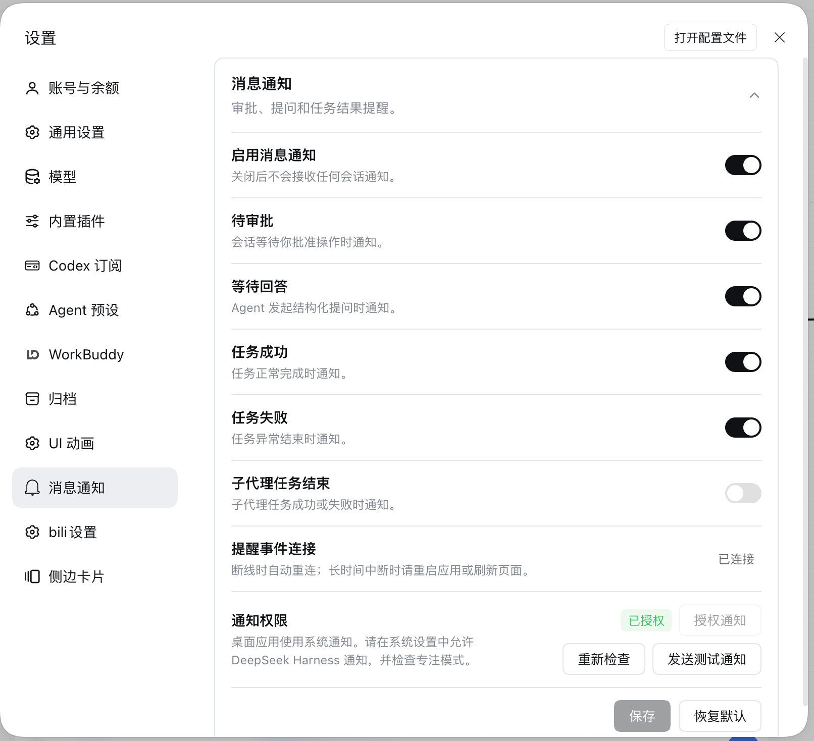
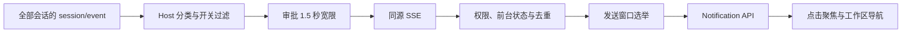

# dsh-notifications

在 DeepSeek Harness 桌面端与 Web 中提醒待审批、结构化提问和任务结果，点击通知即可回到对应会话。

[](README.md)
[](README_en.md)

[](LICENSE)
[](package.json)

## 📑 目录

- [核心功能](#-核心功能)
- [界面预览](#-界面预览)
- [快速开始](#-快速开始)
- [使用与配置](#-使用与配置)
- [工作原理](#-工作原理)
- [开发与测试](#-开发与测试)
- [兼容性与限制](#-兼容性与限制)
- [版本记录](#-版本记录)
- [贡献与许可证](#-贡献与许可证)

## ✨ 核心功能

| 能力 | 行为 |
| --- | --- |
| 全会话提醒 | 待审批、等待回答、任务成功、任务失败四类；取消或中止不提醒 |
| 审批宽限 | 审批在 1.5 秒内被决定（含 `never` 策略自动拒绝）不提醒，避免空提醒 |
| 前台抑制 | 当前会话同时可见且窗口有焦点时不打扰；其他会话或窗口失焦仍提醒 |
| 多窗口去重 | 同一事件只处理一次；BroadcastChannel（缺失时用 localStorage 租约）选出发送窗口 |
| 点击回到会话 | 新版使用工作区导航；子代理使用官方父子地址；旧 Web 保留原接口兜底 |
| 子代理开关 | 可单独关闭子代理任务结果提醒，仍保留子代理审批与提问提醒 |
| 独立设置页 | 「设置 → 消息通知」入口与通知图标，含连接状态、授权、测试、保存、恢复默认与中英文 |
| 最小事件数据 | SSE 只带事件标识和会话 ID，不含聊天正文、问题、审批参数或工具参数 |

## 🖼️ 界面预览



桌面端（macOS）设置页：上方是总开关与五个分类开关，中部是提醒事件连接状态，底部是通知权限、测试通知以及保存与恢复默认。

## 🚀 快速开始

> [!NOTE]
> npm 包名为 **`@ycet/dsh-notifications`**：无作用域的 `dsh-notifications` 已被其他作者占用，与本插件不是同一个项目。

### 方式一：从 npm 安装（推荐）

```sh
# Web 端
dsh plugin --profile web add @ycet/dsh-notifications@0.3.4

# 桌面端（使用应用内附带的官方 CLI）
"/Applications/DeepSeek Harness.app/Contents/Resources/runtime/cli/bin/dsh" plugin --profile desktop add @ycet/dsh-notifications@0.3.4
```

### 方式二：从本地源码安装

源码目录先执行 `pnpm install && pnpm build`，再用实际路径替换占位符。

#### macOS 桌面端

完全退出 DeepSeek Harness 后安装：

```sh
"/Applications/DeepSeek Harness.app/Contents/Resources/runtime/cli/bin/dsh" plugin --profile desktop add "@ycet/dsh-notifications@link:<absolute-path-to-plugin>"
```

#### Web

```sh
dsh plugin --profile web add "@ycet/dsh-notifications@link:<absolute-path-to-plugin>"
dsh web
```

### 方式三：从 GitHub / Release 安装（无需 npm 账号）

```sh
# GitHub 依赖（锁定版本 tag，需要本机有 git）
dsh plugin --profile web add "github:Ycet/dsh-notifications#v0.3.4"

# Release 资产 tarball（无需 git）
dsh plugin --profile web add "https://github.com/Ycet/dsh-notifications/releases/download/v0.3.4/dsh-notifications-0.3.4.tgz"

# 桌面端：把 --profile web 换成 --profile desktop
```

### 安装后启用

1. 打开「设置 → 消息通知」，配置卡片默认展开。
2. 在「通知权限」中完成授权：桌面端在系统设置里允许 DeepSeek Harness，Web 端点击「授权通知」。
3. 确认「提醒事件连接」为「已连接」，点击「发送测试通知」，再按需调整开关并「保存」。

> [!NOTE]
> `link:` 引用源码目录，源码必须保留且依赖可解析。修改 Host 或 bundle 后重启对应应用；修改客户端后重新构建并刷新页面。安装会自动把插件加入 profile 的 bundle 列表。

### 卸载

```sh
dsh plugin --profile web remove @ycet/dsh-notifications
```

桌面端把 `--profile web` 换成 `--profile desktop` 并使用应用内 CLI，然后重启应用。

## 📖 使用与配置

### 开关与默认值

| 字段 | 默认值 | 含义 |
| --- | --- | --- |
| `enabled` | `true` | 消息通知总开关 |
| `approvalPendingEnabled` | `true` | 待审批提醒 |
| `questionPendingEnabled` | `true` | 结构化提问提醒 |
| `taskSucceededEnabled` | `true` | 任务成功提醒 |
| `taskFailedEnabled` | `true` | 任务失败提醒 |
| `subagentTaskEndedEnabled` | `true` | 子代理任务成功或失败提醒 |

主开关关闭时，分类开关不可操作，也不会接收任何会话通知。

### 提醒规则

- 只在窗口不可见、失焦，或提醒所属会话不是当前会话时提醒。
- 同一事件只处理一次；多个窗口之间由选举出的一个窗口发送。
- 审批请求有 1.5 秒宽限期：宽限期内被决定（`never` 策略自动拒绝、立即中止等）则不提醒。
- 取消或中止的回合不提醒；失败提醒来自回合的 error 结果。
- 子代理的任务结束提醒受「子代理任务结束」控制；子代理的审批与提问仍按各自开关提醒。

### 通知权限

桌面端请在系统通知设置中允许 **DeepSeek Harness**，并检查专注模式；Web 需要安全来源（HTTPS 或本机回环地址）并允许该站点通知。授权徽章来自 Notification API，无法判断系统是否拦截了横幅或声音；测试通知发送未抛错也不等于系统横幅已显示。

### 点击通知

点击通知会聚焦 DSH 并打开对应会话；子代理使用官方父子地址。目标已删除，或旧版未提供子代理导航时，仅聚焦窗口，不创建替代会话。

### 配置存储

配置通过 DSH settings 服务按 Loader entry id 持久化，通知权限与系统设置不写入插件配置。保存在其他窗口已更新时会提示冲突，并重新读取配置。

## 🔧 工作原理



### 事件与隐私

事件包含 `eventId`、`type`、`sessionId`、`occurredAt` 和 `subagent`；新版子代理可额外携带 `address`（仅父子会话 ID 和 `mode`），身份来自官方 `subagent` 投影，不扫描私有日志。通知正文只展示会话标题。

### HTTP 接口

| 方法 | 路径 | 用途 |
| --- | --- | --- |
| GET / POST | `/dsh-notifications/api/config` | 读取、保存或恢复配置及 revision |
| GET | `/dsh-notifications/api/events` | SSE 提醒事件流 |
| GET | `/dsh-notifications/api/debug` | 客户端连接数和缓冲事件数，不含会话内容 |

### 连接与重连

接口保留同源与可信 Host 校验；桌面端由官方应用协议代理认证，不开放额外监听端口。首次连接不回放历史；短暂断线依据 Last-Event-ID 补发，内存最多保留 256 条、5 分钟。卸载插件会关闭 SSE、释放选举定时器与审批宽限定时器，并移除设置入口。

### 技术栈

| 层 | 使用 |
| --- | --- |
| Host | Cordis 插件 API、Node HTTP webServer、SSE、Schemastery 配置 |
| Client | React 18、官方 `Switch`（`@deepseek-ai/dsh-client-ui-primitives`）、EventSource、BroadcastChannel |
| 构建 | esbuild 打包为 `__ModuleLoader__` 工厂格式，产物为 [client.js](client.js) |

## 🧪 开发与测试

```sh
pnpm install
pnpm build
pnpm check
pnpm test
```

`pnpm build` 生成构建产物 [client.js](client.js)，请勿手改；`pnpm check` 只做语法检查。测试覆盖四类通知、审批宽限、去重、前台抑制、权限与开关、普通与子代理导航、保存冲突、SSE 补发及资源释放，并保留旧版事件的脱敏 fixture。

使用准备好的官方 DSH 运行时执行集成测试：

```sh
DSH_RUNTIME_DIR="<prepared-dsh-runtime-directory>" pnpm test
```

该目录应包含官方 `node_modules`；未提供时仅跳过该集成测试。集成测试使用真实 Cordis、SessionStore、子代理服务与会话投影，不调用模型或外部业务工具。

## ⚠️ 兼容性与限制

- 桌面兼容目标为 DeepSeek Harness **0.2.1-rc.2 及以上**（`engines.dsh: >=0.2.1-rc.2`）。客户端仍使用 `platform: web`，与官方桌面 Web 渲染器一致。
- 设置页开关复用宿主前端提供的 `@deepseek-ai/dsh-client-ui-primitives`（已声明在 `dsh.client.inject`）。该静态模块自 **0.2.0-rc.2** 起包含官方 `Switch` 组件；低于该版本时设置页开关不可用。
- 子代理地址优先读取官方 `sessionProjections.snapshot`；更老的 0.2.1 运行时退回已弃用的 `stateOf`，两者都不可用时点击通知只聚焦窗口。
- 官方 `settings.section.icon` 插槽存在时不再安装 DOM 图标兜底；旧壳继续使用遮罩方案，因此两条路径不会互相覆盖。
- 保留旧 Web 导航兜底；其他 DSH 版本、操作系统及浏览器需要各自验收，不代表已全部验证。
- 应用或页面必须保持运行；不提供关闭应用后的推送、自定义声音或外部消息渠道。
- 仅识别明确审批/提问事件和结构化提问工具调用，不从普通聊天文本推断通知。未知事件日志只记录类型和字段名。
- 系统通知权限、专注模式和浏览器限制可能阻止提醒显示；窗口崩溃或后台计时器节流可能延迟多窗口重新选举。

## 📝 版本记录

<details>
<summary>展开查看 v0.3.4 至 v0.3.1 的变更</summary>

- **v0.3.4** 消除审批空提醒：Host 把 `approval/asked` 与 `approval/decided` 按审批 id 配对，决定在 1.5 秒宽限期内到达就不再提醒（`never` 策略或立即中止不会再弹「等待审批」）；子代理地址改用官方 `sessionProjections.snapshot` 读取，去掉对已弃用 `stateOf` 的依赖；官方 `settings.section.icon` 插槽接管后不再安装 DOM 图标兜底；集成测试夹具补齐 `workingDirectory` 与 `ctx.plugin` 激活，0.2.2 运行时不再失败。
- **v0.3.3** 修正两处与 DSH 新版本（0.2.2-rc.1）相关的兼容问题：设置导航图标改走官方 `settings.section.icon` 插槽（旧壳继续由遮罩方案兜底）；三条 `/api/*` 路由的信任围栏改由官方 Host `connection.requestRejection` 判定，修掉「读取不存在的 `webRuntime` 服务导致受信远程主机一律 403」的老缺陷。同时补上 `engines.dsh`，让 DSH 的插件兼容性门禁对本事生效。
- **v0.3.2** 把「设置 → 消息通知」的 6 个功能开关改为 DSH 官方 `@deepseek-ai/dsh-client-ui-primitives` 的 `Switch` 组件，尺寸、配色、禁用态与焦点环与官方设置页一致；主开关关闭时子开关只呈现官方禁用态。
- **v0.3.1** 将配置入口迁移至「设置 → 消息通知」，原通知开关和已保存配置保留；鲸鱼图标变色、颜色状态显示及对应状态追踪已移除，旧配置中的 `faviconEnabled` 会被忽略。

</details>

## 🤝 贡献与许可证

通过 [Issues](https://github.com/Ycet/dsh-notifications/issues) 提供 DSH 版本、操作系统、通知权限和脱敏复现步骤。贡献按 Fork → 分支 → Pull Request 提交；不要提交聊天内容、工具参数或凭据。

许可证：[MIT](LICENSE)。
