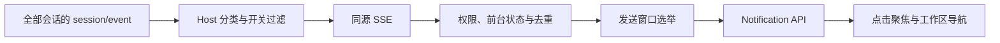

# dsh-notifications

在 DeepSeek Harness 桌面端和 Web 中提醒待审批、结构化提问及任务结果，点击通知打开对应会话。

[](README.md)
[](README_en.md)

[](LICENSE)
[](package.json)

## 📑 目录

- [功能](#-功能)
- [快速开始](#-快速开始)
- [使用与配置](#-使用与配置)
- [工作原理](#-工作原理)
- [开发与测试](#-开发与测试)
- [兼容性与限制](#-兼容性与限制)
- [贡献与许可证](#-贡献与许可证)

## ✨ 功能

| 功能 | 行为 |
| --- | --- |
| 全会话提醒 | 待审批、等待回答、任务成功和任务失败；取消或中止不提醒 |
| 桌面与 Web | 使用 Notification API；桌面通知由操作系统显示 |
| 前台抑制 | 当前会话同时可见且窗口有焦点时不提醒；支持新版主视图绑定 |
| 通知去重 | 相同事件只处理一次；多个窗口通过 BroadcastChannel 或 localStorage 租约选出发送者 |
| 点击打开会话 | 新版使用工作区导航；子代理使用官方父子地址；旧 Web 保留原接口兜底 |
| 子代理开关 | 可关闭子代理任务结果提醒，仍保留子代理待审批和提问提醒 |
| 独立设置 | 「设置 → 消息通知」入口及通知图标，支持连接状态、授权、测试结果、保存、恢复默认及中英文 |
| 最小事件数据 | SSE 不包含聊天正文、问题、审批参数或工具参数 |

**v0.3.2 把「设置 → 消息通知」的 6 个功能开关改为 DSH 官方 `@deepseek-ai/dsh-client-ui-primitives` 的 `Switch` 组件，尺寸、配色、禁用态与焦点环与官方设置页一致；主开关关闭时子开关只呈现官方禁用态，不再整行降低透明度。** 依赖已写入 `dsh.client.inject`，最低支持 DeepSeek Harness 0.2.0-rc.2。

**v0.3.1 将配置入口迁移至「设置 → 消息通知」，原通知开关和已保存配置保留。** 鲸鱼图标变色、颜色状态显示及对应状态追踪已移除，旧配置中的 `faviconEnabled` 会被忽略。

## 🚀 快速开始

源码目录先执行 `pnpm install` 和 `pnpm build`，然后使用实际源码路径替换占位符。

### macOS 桌面端

完全退出 DeepSeek Harness，使用应用内附带的官方 CLI 安装：

```sh
"/Applications/DeepSeek Harness.app/Contents/Resources/runtime/cli/bin/dsh" plugin --profile desktop add "dsh-notifications@link:<absolute-path-to-plugin>"
```

重新打开应用，在设置左侧选择「消息通知」，检查权限并发送测试通知。

### Web

```sh
dsh plugin --profile web add "dsh-notifications@link:<absolute-path-to-plugin>"
dsh web
```

打开 DSH，在「消息通知」配置中授权通知并发送测试通知。

> [!NOTE]
> `link:` 引用源码目录，源码必须保留且依赖可解析。修改 Host 或 bundle 后重启对应应用；修改客户端后重新构建并刷新。安装会自动加入 profile 的 bundle 列表。

卸载时，使用相同 CLI 和 profile，将 `add ...` 替换为 `remove dsh-notifications`，再重启对应应用。

## 📖 使用与配置

打开「设置 → 消息通知」，配置卡片默认展开。先确认提醒事件连接为「已连接」，修改开关后点击「保存」。主开关关闭时，分类开关不可操作。保存遇到其他窗口更新会提示冲突并重新读取配置。

| 字段 | 默认值 | 含义 |
| --- | --- | --- |
| `enabled` | `true` | 消息通知总开关 |
| `approvalPendingEnabled` | `true` | 待审批提醒 |
| `questionPendingEnabled` | `true` | 结构化提问提醒 |
| `taskSucceededEnabled` | `true` | 任务成功提醒 |
| `taskFailedEnabled` | `true` | 任务失败提醒 |
| `subagentTaskEndedEnabled` | `true` | 子代理任务成功或失败提醒 |

配置通过 DSH settings 服务持久化，按 Loader entry id 定址。通知权限由浏览器或操作系统管理，不存入插件配置。

桌面端请在系统通知设置中允许 **DeepSeek Harness**，并检查专注模式。授权状态来自 Notification API，无法判断系统是否拦截了横幅或声音。Web 需要安全地址（HTTPS 或本机回环地址）并允许该站点通知。

点击通知会聚焦 DSH 并打开目标会话；目标已删除或旧版未提供子代理导航时，仅聚焦窗口，不创建替代会话。

## 🔧 工作原理



事件包含 `eventId`、`type`、`sessionId`、`occurredAt` 和 `subagent`。新版子代理可额外携带 `address`（仅父子会话 ID 和 `mode`），身份来自官方 `subagent` 投影，不扫描私有日志。通知正文只展示会话标题。

| 方法 | 路径 | 用途 |
| --- | --- | --- |
| GET / POST | `/dsh-notifications/api/config` | 读取、保存或恢复配置及 revision |
| GET | `/dsh-notifications/api/events` | SSE 提醒事件流 |
| GET | `/dsh-notifications/api/debug` | 客户端连接数和缓冲事件数，不含会话内容 |

接口保留同源与可信 Host 校验。桌面端由官方应用协议代理认证，不开放额外监听端口。首次连接不回放历史；短暂断线依据 Last-Event-ID 补发，内存最多保留 256 条、5 分钟。卸载插件会关闭 SSE、释放选举定时器和移除设置入口。

## 🧪 开发与测试

```sh
pnpm install
pnpm build
pnpm check
pnpm test
```

测试覆盖四类通知、去重、前台抑制、权限与开关、普通和子代理导航、保存冲突、SSE 补发及资源清理；保留旧版事件的脱敏 fixture。

使用准备好的官方 DSH 运行时执行集成测试：

```sh
DSH_RUNTIME_DIR="<prepared-dsh-runtime-directory>" pnpm test
```

该目录应包含官方 `node_modules`；未提供时仅跳过该集成测试。集成测试使用真实 Cordis、SessionStore、子代理服务与会话投影，不调用模型或外部业务工具。

## ⚠️ 兼容性与限制

- 桌面兼容目标为 DeepSeek Harness **0.2.0-rc.2**。客户端仍使用 `platform: web`，与官方桌面 Web 渲染器一致。
- 设置页开关复用宿主前端提供的 `@deepseek-ai/dsh-client-ui-primitives`（已声明在 `dsh.client.inject`）。该静态模块自 **0.2.0-rc.2** 起包含官方 `Switch` 组件；低于该版本时设置页开关不可用。
- 保留旧 Web 导航兜底；其他 DSH 版本、操作系统及浏览器需要各自验收，不代表已全部验证。
- 应用或页面必须保持运行；不提供关闭应用后的推送、自定义声音或外部消息渠道。
- 仅识别明确审批/提问事件和结构化提问工具调用，不从普通聊天文本推断通知。未知事件日志只记录类型和字段名。
- 系统通知权限、专注模式和浏览器限制可能阻止提醒显示。测试通知发送未抛错不等于系统横幅已显示。
- 窗口崩溃或后台计时器节流可能延迟多窗口重新选举。

## 🤝 贡献与许可证

通过 [Issues](https://github.com/Ycet/dsh-notifications/issues) 提供 DSH 版本、操作系统、通知权限和脱敏复现步骤。贡献按 Fork → 分支 → Pull Request 提交；不要提交聊天内容、工具参数或凭据。

许可证：[MIT](LICENSE)。
