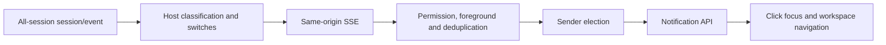

# dsh-notifications

Desktop and Web alerts for DeepSeek Harness approvals, structured questions and task outcomes, with session navigation.

[](README.md)
[](README_en.md)

[](LICENSE)
[](package.json)

## 📑 Contents

- [Features](#-features)
- [Quick start](#-quick-start)
- [Usage and settings](#-usage-and-settings)
- [Architecture](#-architecture)
- [Development and tests](#-development-and-tests)
- [Compatibility and limits](#-compatibility-and-limits)
- [Contributing and license](#-contributing-and-license)

## ✨ Features

| Feature | Behavior |
| --- | --- |
| All-session alerts | Approvals, structured questions, success and failure; cancellation and abort remain silent |
| Desktop and Web | Notification API delivery; Desktop notifications are displayed by the OS |
| Foreground suppression | Suppress the selected session when visible and focused; supports the new main-view binding |
| Deduplication | Process each event once; elect a sender across windows using BroadcastChannel or a localStorage lease |
| Session navigation | Workspace navigation and official parent/child addresses, with legacy Web fallbacks |
| Subagent switch | Disable child task results while retaining child approval and question alerts |
| Dedicated settings | Settings → Notifications with a bell icon, bilingual controls, stream status, permission checks, test results, save and reset |
| Minimal event data | SSE excludes chat text, questions, approval arguments and tool arguments |

**v0.3.2 replaces the six toggles on Settings → Notifications with DSH's official `Switch` from `@deepseek-ai/dsh-client-ui-primitives`, so size, colors, disabled state and focus ring match the official settings pages; child toggles now show only the official disabled state instead of dimming the whole row.** The dependency is declared in `dsh.client.inject`; the minimum supported version is DeepSeek Harness 0.2.0-rc.2.

**v0.3.1 moves configuration to Settings → Notifications, preserving existing switches and saved configuration.** Whale icon recoloring, color display and its state tracking have been removed. Legacy `faviconEnabled` values are ignored.

## 🚀 Quick start

Run `pnpm install` and `pnpm build` in the source directory, then replace the path placeholder with the source path.

### macOS Desktop

Fully quit DeepSeek Harness and install using the official bundled CLI:

```sh
"/Applications/DeepSeek Harness.app/Contents/Resources/runtime/cli/bin/dsh" plugin --profile desktop add "dsh-notifications@link:<absolute-path-to-plugin>"
```

Reopen the application, select Notifications in the settings sidebar, check access and send a test notification.

### Web

```sh
dsh plugin --profile web add "dsh-notifications@link:<absolute-path-to-plugin>"
dsh web
```

Open DSH, grant notification access in Notifications settings and send a test notification.

> [!NOTE]
> A `link:` dependency requires keeping its source and resolvable dependencies. Restart after Host or bundle changes; rebuild and refresh after client changes. Installation automatically adds the plugin to the profile bundle list.

To uninstall, use the same CLI and profile, replace `add ...` with `remove dsh-notifications`, then restart.

## 📖 Usage and settings

Open Settings → Notifications. The configuration card starts expanded. Confirm the alert stream is Connected, adjust switches and save. Category controls are disabled when the master switch is off. A conflicting save from another window shows an error and reloads settings.

| Field | Default | Purpose |
| --- | --- | --- |
| `enabled` | `true` | Master switch |
| `approvalPendingEnabled` | `true` | Approval alerts |
| `questionPendingEnabled` | `true` | Structured question alerts |
| `taskSucceededEnabled` | `true` | Successful task alerts |
| `taskFailedEnabled` | `true` | Failed task alerts |
| `subagentTaskEndedEnabled` | `true` | Subagent success and failure alerts |

DSH settings persist configuration by Loader entry id. Notification access belongs to the browser or OS and is not stored in plugin configuration.

On Desktop, allow **DeepSeek Harness** in OS notification settings and check Focus mode. The badge reports Notification API access; it cannot detect OS banner or sound suppression. Web requires a secure origin (HTTPS or loopback) and site notification access.

Clicking an alert focuses DSH and opens its session. Deleted targets or unavailable legacy child navigation only focus the window; no replacement session is created.

## 🔧 Architecture



Events contain `eventId`, `type`, `sessionId`, `occurredAt` and `subagent`. Modern child events may include `address` (parent/child IDs and `mode` only), sourced from the official `subagent` projection without reading private logs. Notification bodies contain only the session title.

| Method | Path | Purpose |
| --- | --- | --- |
| GET / POST | `/dsh-notifications/api/config` | Read, save or reset configuration and revision |
| GET | `/dsh-notifications/api/events` | SSE alert stream |
| GET | `/dsh-notifications/api/debug` | Client and buffered-event counts without session content |

Routes retain same-origin and trusted-host checks. The official Desktop protocol proxy owns authentication; no additional port is opened. Initial connections do not replay history. Short reconnects replay after Last-Event-ID, with at most 256 events retained for five minutes. Disposal closes SSE, releases election timers and removes settings.

## 🧪 Development and tests

```sh
pnpm install
pnpm build
pnpm check
pnpm test
```

Tests cover all four alert types, deduplication, foreground suppression, permissions and switches, root and child navigation, save conflicts, SSE replay and cleanup. Redacted fixtures retain the older event contract.

Run integration against a prepared official DSH runtime:

```sh
DSH_RUNTIME_DIR="<prepared-dsh-runtime-directory>" pnpm test
```

The directory must contain official `node_modules`. Without it, only this integration test is skipped. Integration uses real Cordis, SessionStore, subagent services and projections without calling models or external business tools.

## ⚠️ Compatibility and limits

- Desktop compatibility targets DeepSeek Harness **0.2.0-rc.2**. The client remains `platform: web`, matching the official Desktop renderer.
- Settings toggles reuse `@deepseek-ai/dsh-client-ui-primitives` from the host frontend, declared in `dsh.client.inject`. That static module has shipped the official `Switch` since **0.2.0-rc.2**; below that version the settings toggles are unavailable.
- Legacy Web navigation fallbacks remain. Other versions, OSes and browsers require their own validation; they are not all verified.
- The application or page must remain running. There is no push after shutdown, custom sound or external messaging channel.
- Only explicit approval/question events and structured question calls trigger interaction alerts. Ordinary chat text is not scanned. Unknown-event diagnostics log types and field names only.
- OS settings, Focus mode and browser restrictions can block display. A successful test API call alone does not prove a banner was shown.
- Window crashes or background timer throttling may delay sender re-election.

## 🤝 Contributing and license

Use [Issues](https://github.com/Ycet/dsh-notifications/issues) to report DSH and OS versions, notification access and redacted reproduction steps. Contribute through Fork → branch → Pull Request. Do not submit chat contents, tool arguments or credentials.

License: [MIT](LICENSE).
