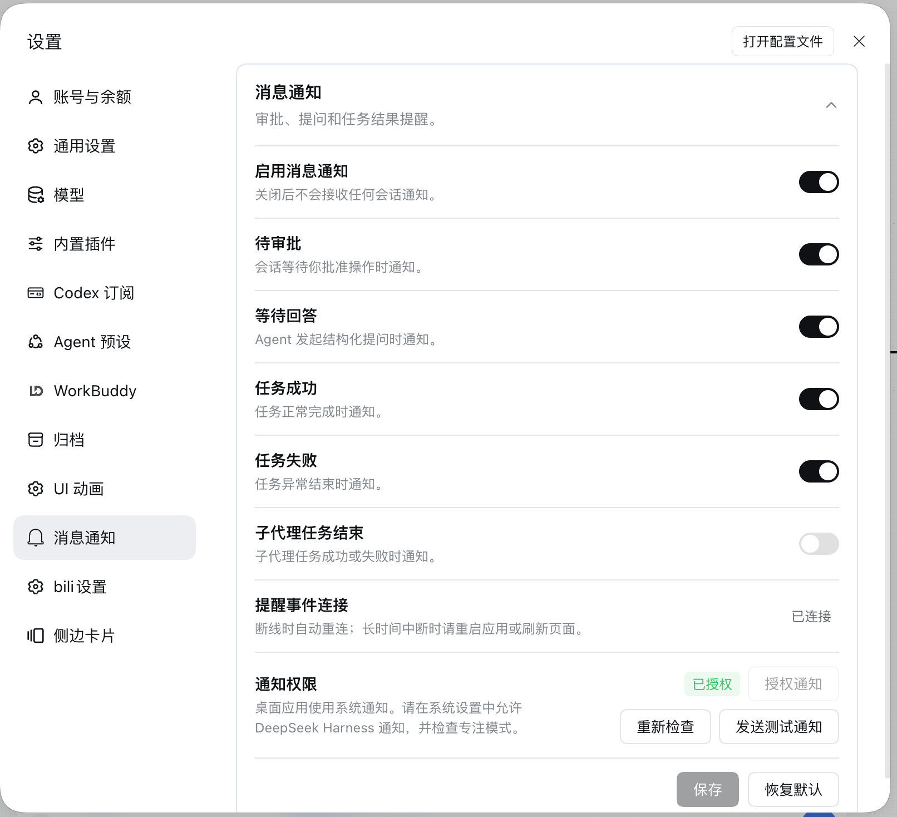
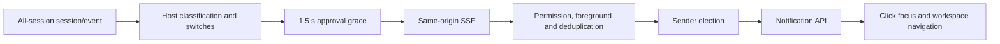

# dsh-notifications

Approval, question and task alerts for DeepSeek Harness on Desktop and Web, with one click back to the session.

[](README.md)
[](README_en.md)

[](LICENSE)
[](package.json)

## 📑 Contents

- [Features](#-features)
- [Preview](#-preview)
- [Quick start](#-quick-start)
- [Usage and settings](#-usage-and-settings)
- [How it works](#-how-it-works)
- [Development and tests](#-development-and-tests)
- [Compatibility and limits](#-compatibility-and-limits)
- [Release notes](#-release-notes)
- [Contributing and license](#-contributing-and-license)

## ✨ Features

| Capability | Behavior |
| --- | --- |
| All-session alerts | Approvals, questions, successful and failed tasks; cancellations and aborts stay silent |
| Approval grace period | No alert when the approval is decided within 1.5 seconds (including automatic rejection under the `never` policy) |
| Foreground suppression | Stay quiet when the target session is visible and the window is focused; other sessions or an unfocused window still alert |
| Multi-window deduplication | Process each event once; elect one sending window through BroadcastChannel or a localStorage lease |
| Click to reopen | Workspace navigation and official parent/child addresses, with legacy Web fallbacks |
| Subagent switch | Disable subagent task-result alerts while keeping subagent approval and question alerts |
| Dedicated settings | A Settings → Notifications entry with a bell icon, stream status, permission checks, test delivery, save, reset and Chinese/English UI |
| Minimal event data | SSE carries event identity and session ID only, never chat text, questions, approval arguments or tool arguments |

## 🖼️ Preview



The macOS Desktop settings page: the master switch and five category switches on top, the alert stream status in the middle, and notification permission, test delivery plus save and reset at the bottom.

## 🚀 Quick start

> [!NOTE]
> The npm package is **`@ycet/dsh-notifications`**: the unscoped `dsh-notifications` name belongs to another author and is a different project.

### Option 1: Install from npm (recommended)

```sh
# Web
dsh plugin --profile web add @ycet/dsh-notifications@0.3.4

# Desktop (CLI bundled with the app)
"/Applications/DeepSeek Harness.app/Contents/Resources/runtime/cli/bin/dsh" plugin --profile desktop add @ycet/dsh-notifications@0.3.4
```

### Option 2: Install from local source

Run `pnpm install && pnpm build` in the source directory, then replace the placeholder with the real path.

#### macOS Desktop

Fully quit DeepSeek Harness, then install:

```sh
"/Applications/DeepSeek Harness.app/Contents/Resources/runtime/cli/bin/dsh" plugin --profile desktop add "@ycet/dsh-notifications@link:<absolute-path-to-plugin>"
```

#### Web

```sh
dsh plugin --profile web add "@ycet/dsh-notifications@link:<absolute-path-to-plugin>"
dsh web
```

### Option 3: Install from GitHub / a Release asset (no npm account)

```sh
# GitHub dependency (pinned to a release tag; requires git)
dsh plugin --profile web add "github:Ycet/dsh-notifications#v0.3.4"

# Release asset tarball (no git required)
dsh plugin --profile web add "https://github.com/Ycet/dsh-notifications/releases/download/v0.3.4/dsh-notifications-0.3.4.tgz"

# Desktop: replace --profile web with --profile desktop
```

### Enable after installation

1. Open Settings → Notifications; the configuration card starts expanded.
2. Grant access under Notification permission: allow DeepSeek Harness in OS settings on Desktop, or click Allow notifications on Web.
3. Confirm the alert stream shows Connected, click Send test notification, then adjust switches and Save as needed.

> [!NOTE]
> A `link:` dependency requires keeping its source and resolvable dependencies. Restart after Host or bundle changes; rebuild and refresh after client changes. Installation automatically adds the plugin to the profile bundle list.

### Uninstall

```sh
dsh plugin --profile web remove @ycet/dsh-notifications
```

On Desktop, replace `--profile web` with `--profile desktop`, use the bundled CLI, then restart.

## 📖 Usage and settings

### Switches and defaults

| Field | Default | Purpose |
| --- | --- | --- |
| `enabled` | `true` | Master switch |
| `approvalPendingEnabled` | `true` | Approval alerts |
| `questionPendingEnabled` | `true` | Structured question alerts |
| `taskSucceededEnabled` | `true` | Successful task alerts |
| `taskFailedEnabled` | `true` | Failed task alerts |
| `subagentTaskEndedEnabled` | `true` | Subagent success and failure alerts |

With the master switch off, category controls are disabled and no conversation alert is delivered.

### Alert rules

- Alerts fire only when the window is hidden, unfocused, or the alert's session is not the current one.
- Each event is processed once; among multiple windows, one elected window sends it.
- Approvals have a 1.5-second grace period: a request decided within it (automatic rejection under `never`, immediate abort, and so on) stays silent.
- Cancelled or aborted turns stay silent; failure alerts come from a turn that ended with an error.
- Subagent task-end alerts follow the Subagent task ended switch; subagent approvals and questions still follow their own switches.

### Notification permission

On Desktop, allow **DeepSeek Harness** in OS notification settings and check Focus mode; Web requires a secure origin (HTTPS or loopback) with site notification access. The badge reports Notification API access and cannot detect OS banner or sound suppression; a successful test call alone does not prove a banner was shown.

### Clicking an alert

Clicking an alert focuses DSH and opens its session; subagents use the official parent/child address. Deleted targets, or legacy shells without child navigation, only focus the window and never create a replacement session.

### Configuration storage

DSH settings persist configuration by Loader entry id; notification permission and OS settings are not stored in plugin configuration. If another window saved first, the save reports a conflict and reloads the configuration.

## 🔧 How it works



### Events and privacy

Events contain `eventId`, `type`, `sessionId`, `occurredAt` and `subagent`; modern child events may add `address` (parent/child IDs and `mode` only), sourced from the official `subagent` projection without reading private logs. Notification bodies contain the session title only.

### HTTP endpoints

| Method | Path | Purpose |
| --- | --- | --- |
| GET / POST | `/dsh-notifications/api/config` | Read, save or reset configuration and revision |
| GET | `/dsh-notifications/api/events` | SSE alert stream |
| GET | `/dsh-notifications/api/debug` | Client and buffered-event counts without session content |

### Connection and reconnect

Routes keep same-origin and trusted-host checks; the official Desktop protocol proxy owns authentication and no extra port is opened. Initial connections do not replay history; short reconnects replay after Last-Event-ID, with at most 256 events retained for five minutes. Disposal closes SSE, releases election and approval-grace timers, and removes the settings entry.

### Stack

| Layer | Uses |
| --- | --- |
| Host | Cordis plugin API, Node HTTP webServer, SSE, Schemastery config |
| Client | React 18, official `Switch` (`@deepseek-ai/dsh-client-ui-primitives`), EventSource, BroadcastChannel |
| Build | esbuild bundling into the `__ModuleLoader__` factory format, emitted as [client.js](client.js) |

## 🧪 Development and tests

```sh
pnpm install
pnpm build
pnpm check
pnpm test
```

`pnpm build` generates the build artifact [client.js](client.js); do not edit it by hand. `pnpm check` only checks syntax. Tests cover all four alert types, the approval grace period, deduplication, foreground suppression, permissions and switches, root and subagent navigation, save conflicts, SSE replay and cleanup, and keep redacted fixtures for the older event contract.

Run integration against a prepared official DSH runtime:

```sh
DSH_RUNTIME_DIR="<prepared-dsh-runtime-directory>" pnpm test
```

The directory must contain official `node_modules`; without it only this integration test is skipped. Integration uses real Cordis, SessionStore, subagent services and projections without calling models or external business tools.

## ⚠️ Compatibility and limits

- Desktop compatibility targets DeepSeek Harness **0.2.1-rc.2** or newer (`engines.dsh: >=0.2.1-rc.2`). The client remains `platform: web`, matching the official Desktop renderer.
- Settings toggles reuse `@deepseek-ai/dsh-client-ui-primitives` from the host frontend, declared in `dsh.client.inject`. That static module has shipped the official `Switch` since **0.2.0-rc.2**; below that version the settings toggles are unavailable.
- Child addresses prefer the official `sessionProjections.snapshot`; older 0.2.1 runtimes fall back to the deprecated `stateOf`, and when neither is available a click only focuses the window.
- The DOM icon fallback is not installed when the official `settings.section.icon` slot exists; older shells keep the mask-based fallback, so the two paths never overlap.
- Legacy Web navigation fallbacks remain. Other DSH versions, OSes and browsers require their own validation; they are not all verified.
- The application or page must remain running. There is no push after shutdown, custom sound or external messaging channel.
- Only explicit approval/question events and structured question calls trigger interaction alerts; ordinary chat text is not scanned. Unknown-event diagnostics log types and field names only.
- OS notification settings, Focus mode and browser restrictions can block display; window crashes or background timer throttling may delay multi-window re-election.

## 📝 Release notes

<details>
<summary>Expand for changes from v0.3.4 back to v0.3.1</summary>

- **v0.3.4** Removes empty approval alerts: the host pairs `approval/asked` with `approval/decided` by approval id, so a decision arriving within the 1.5-second grace period stays silent (`never` policy or immediate aborts no longer raise a waiting-for-approval alert). Child addresses are read through the official `sessionProjections.snapshot` instead of the deprecated `stateOf`, the DOM icon fallback is no longer installed once the official `settings.section.icon` slot takes over, and the integration fixture now provides `workingDirectory` and activates through `ctx.plugin`, so it no longer fails on 0.2.2 runtimes.
- **v0.3.3** Fixes two compatibility problems with DSH 0.2.2-rc.1: the settings navigation icon now uses the official `settings.section.icon` slot (older shells keep the mask-based fallback), and the trust fence of all three `/api/*` routes delegates to the official host `connection.requestRejection`, fixing the long-standing defect where the non-existent `webRuntime` service made every trusted remote host receive 403. `engines.dsh` is declared so DSH's plugin compatibility gate applies.
- **v0.3.2** Replaces the six toggles on Settings → Notifications with DSH's official `Switch` from `@deepseek-ai/dsh-client-ui-primitives`, so size, colors, disabled state and focus ring match the official settings pages; child toggles now show only the official disabled state.
- **v0.3.1** Moves configuration to Settings → Notifications, preserving existing switches and saved configuration; whale icon recoloring, color display and its state tracking are removed, and legacy `faviconEnabled` values are ignored.

</details>

## 🤝 Contributing and license

Use [Issues](https://github.com/Ycet/dsh-notifications/issues) to report DSH and OS versions, notification access and redacted reproduction steps. Contribute through Fork → branch → Pull Request. Do not submit chat contents, tool arguments or credentials.

License: [MIT](LICENSE).
